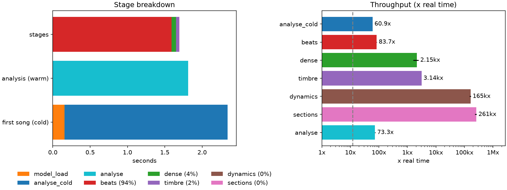

# Step 02: Music Features

**Goal:** turn a song into a **per-beat feature table** (plus a dense per-frame curve) that describes rhythm, energy and *how energy changes* (Δ, Δ²). These are the "music dynamics" that drive the edit.

← [01 Decoding & proxies](../01-decoding-and-proxies/README.md) · [Project plan](../README.md) · Next → [03 Shot detection](../03-shot-detection/README.md)

---

## 1. Concepts

- **Beat grid:** AMV editing is anchored to beats and especially **downbeats** (first beat of a bar). Cuts, flashes and zooms land on them.
- **Two time resolutions:**
  - *Dense*: fixed frame rate (43 Hz, from hop 512 @ 22.05 kHz), used for smoothing, plots, control windows (resampled to 10 Hz in step 07).
  - *Beat*: one row per beat, the main unit for timing models and conditioning.
- **Dynamics:** the architecture uses `m`, `Δm`, `Δ²m`. Differentiation **amplifies noise**, so smooth first, then differentiate.

## 2. Inputs / outputs

| | Path | Content |
|---|---|---|
| In | `data/cache/songs.parquet` ([step 01, task 3.7](../01-decoding-and-proxies/README.md#37-song-table-)): one row per AMV in `data/amvs/` and per file in `data/songs/` | `song_id`, `audio_proxy_path` (22 050 Hz mono wav), the original's audio metadata |
| Out | `data/cache/music/<song_id>_<settings_id>_dense.npz` | `times[T]`, feature matrix `[T, 12]` (the 6 normalised curves, then their `_s` versions), feature names |
| Out | `data/cache/music/<song_id>_<settings_id>_beats.parquet` | one row per beat (schema below) |

### Beat table schema

| Column | Type | Meaning |
|---|---|---|
| `t` | float | beat time (s) |
| `is_downbeat` | bool | |
| `beat_in_bar` | int | 0..3 (for 4/4) |
| `bar_idx` | int | -1 for pickup beats before the first downbeat |
| `ibi` | float | inter-beat interval (s), local tempo = 60/ibi |
| `rms`, `onset`, `flux`, `low`, `mid`, `high` | float | features pooled over the beat interval [t_i, t_{i+1}) |
| `*_s` | float | smoothed version of each |
| `*_d1`, `*_d2` | float | first/second derivative of the smoothed version, **per beat** |
| `section` | str | intro / build / drop / break / outro (heuristic, see 3.5) |

## 3. Tasks

| Task | Status | Code | Tests |
|---|---|---|---|
| 3.1 Load | ✅ done | `amv/music/audio.py` | `tests/music/test_audio.py` |
| 3.2 Beats & downbeats | ✅ done | `amv/music/beats.py` | `tests/music/test_beats.py` |
| 3.3 Dense features | ✅ done | `amv/music/dense.py` | `tests/music/test_dense.py` |
| 3.4 Smoothing + derivatives | ✅ done | `amv/music/dynamics.py` | `tests/music/test_dynamics.py` |
| 3.5 Section labels | ✅ done | `amv/music/dense.py::compute_timbre_features`, `amv/music/sections.py` | `tests/music/test_sections.py` |
| 3.6 Beat table & script | ✅ done | `amv/music/analysis.py`, `scripts/analyse_music.py` | `tests/music/test_analysis.py` |
| 3.7 Plot & click track | ✅ done | `checks/music.py`, `checks/plot_music.py`, `checks/settings.py` | `tests/checks/` |
| 3.9 Section tuning | ✅ done | `amv/music/sections.py`, `amv/config.py`, `amv/music/analysis.py`, `checks/` | `tests/music/test_sections.py`, `tests/checks/test_music.py` |
| 3.8 Timing benchmark | ✅ done | `benchmarks/bench_02_music.py`; shared: `benchmarks/timing.py`, `plots.py`, `results.py` | `tests/benchmarks/test_timing.py`, `test_settings.py` (benchmark itself: no tests, see 3.8) |

3.1–3.5 are building blocks; 3.6 runs them on every song and writes the outputs in section 2; 3.7 reads those files, so it checks exactly what later steps read. 3.9 is judged with the 3.7 plots. 3.8 can be done any time.

### 3.1 Load ✅
- Load mono at 22 050 Hz, peak-normalised, so features are comparable across songs.
- *Implemented as:* step 01 makes every wav and the song table. `load_audio` only reads mono wavs at `MUSIC.sample_rate` with `soundfile` (anything else raises) and peak-normalises; resampling stays in step 01.

### 3.2 Beats & downbeats ✅
- `beat_this` (CPU) for beat and downbeat times.
- *Implemented as:* on Blue Lock, `beat_this` tracks the half-time breakdown at half tempo and its downbeats give bars of 1–7 beats, so the planned "IBI < 0.25 s or > 1.5 s" rule is replaced:
  - `clean_beats` drops beats < `min_ibi` after the last kept beat, then splits every interval of ≈ n × the median IBI (n ≥ 2) into n parts.
  - `build_beat_grid` treats downbeats as votes: per beat, the bar phase is the majority residue (beat index mod 4) over ±`downbeat_window_bars` bars.
  - Result on Blue Lock: a steady 176.5 BPM, 89/90 bars with 4 beats.
- *Known limitation:* the median is song-wide, so a real tempo change can be misread as half tempo. A warning is logged if > 5% of the intervals split into parts more than 10% off the median (a synthetic 1.7× tempo change: 40%; real songs: ≤ 2.1%). Switch to a local median if a real song hits this.
- *Measured (CPU):* `detect_beats` ~3 s on a 2:13 song; `clean_beats` + `build_beat_grid` < 15 ms.

### 3.3 Dense features (hop = 512 → ~43 Hz) ✅
- `rms`, `onset` (onset strength), `flux` (spectral flux), and mel band energies `low` (< 200 Hz), `mid`, `high` (> 4 kHz). Robust-normalised per song (subtract median, divide by IQR).
- *Implemented as:* one STFT feeds every feature. Only `rms` and the bands go through dB (`onset` and `flux` are differences with many zeros). A column with IQR 0 becomes zeros. `flux` gets the same frame shift as `onset_strength`, or it runs 46 ms ahead. HPSS is left out; add it only if the onset curve looks muddy.
- `flux` stays next to `onset`: aligned, their correlation is only 0.29–0.67.
- Both attack curves are heavy-tailed: normalised peaks of 12–49 (`onset`) and 4–10 (`flux`), against ≤ 4.1 for `rms` and the bands.
- *Measured (CPU):* 0.12–0.21 s per song.

### 3.4 Smoothing + derivatives ✅
- Savitzky–Golay smoothing; pool dense → beat; `_d1`, `_d2` at beat level, which is what the dynamics model sees.
- *Implemented as:*
  - The **raw** dense curves are pooled (averaging over a beat already smooths over one beat). `pool_to_beats` gives beat *i* the frames in [t_i, t_{i+1}); the last beat gets one more interval of the previous length, so an outro after it isn't averaged in.
  - `smooth_dense` makes the dense `_s` curves (for the npz, the plot and step 07): polyorder 2, odd window nearest to `dense_sg_window_beats` × the median IBI in frames.
  - `beat_dynamics` runs SG on the pooled series: `beat_sg_window` = 5 beats, polyorder 2, `mode="interp"`, `delta=1`. So `_d1`/`_d2` are **per beat, not per second**, and don't change with tempo.
- *Checked:* `rms_d2` isn't white noise. Inside Blue Lock's drops |`rms_d2`| ≤ 0.05; it spikes only at fills and section changes.
- *Measured (CPU, 3-min synthetic song):* the whole of 3.4 takes 1.5 ms.

### 3.5 Section labels (heuristic, the "plan" tokens) ✅
- Novelty from bar-level timbre self-similarity, boundaries at novelty peaks on downbeats, segments labelled by energy and trend. Imperfect is fine: step 07 can learn better labels, step 13 lets the user override them.
- *Implemented as:*
  - **Features:** `compute_timbre_features` (12 MFCCs without mfcc_0, plus 12 chroma), pooled per bar on the downbeats.
  - **Novelty:** `section_novelty` z-scores each column, takes the cosine self-similarity of the bars, and slides a `section_kernel_bars` = 8 Gaussian checkerboard kernel (|K| sums to 1) along the diagonal. It is not rescaled, so a perfect change scores 1 and `novelty_prominence` = 0.1 is an absolute threshold. No `librosa.segment`, no 8/16-bar snapping: boundaries are bar indices, so they're on downbeats by construction.
  - **Boundaries:** `find_section_boundaries` keeps the `scipy.signal.find_peaks` peaks at least `min_section_bars` apart, minus an edge zone (changed in 3.9).
  - **Labels:** `label_sections` ranks segments **within the song** by energy = mean `rms_s`. "0.5 IQR above the median" almost never fired, because in a loud song the drops are the median. Rules, first match wins:
    1. level ≥ `drop_level` → drop
    2. rise (sum of `rms_d1`) ≥ `build_rise` **and the next segment is a drop** → build (so fade-in intros aren't builds)
    3. otherwise intro / outro / break, by position
- `section_novelty` and `find_section_boundaries` are separate so the 3.7 plot can draw the novelty.
- *Known limitation:* z-scoring stretches any song's variation to unit size, so a song without real sections still gets boundaries.
- *Measured (CPU):* timbre features ~0.22 s per song (up to 1.7 s on the first call of a session); boundaries + labels 0.4 ms.

### 3.6 Beat table & script ✅
- Run 3.1–3.5 on every song in the song table and write the two outputs in section 2. Load `beat_this` once per run. Skip songs that are already cached, write atomically, and only cache what later steps read.
- *Implemented as:*
  - **Config:** `MusicSettings` / `MUSIC` in `amv/config.py`, holding every setting that changes the outputs. Its `settings_id` is part of the file names, and a `settings_<id>.json` sidecar records what each id stands for.
  - **Functions:** `analyse_song` gets one song, computing it if needed. `analyse_songs` makes sure the cache is complete and skips cached songs without loading them. `load_analysis` reads a song back for later steps. The model is an argument, so the tests use a fake one.
  - **Running it:** `python -m scripts.analyse_music [-v]`. Errors stop the run.
- *Known limitation (as in step 01):* a code change without a settings change doesn't invalidate the cache.
- *Measured 2026-11-11 (laptop CPU, songs of 133–200 s):* 3.9–7.5 s per song, 25–35× real time. A second run analyses nothing. 2026-11-23: all 33 songs in 89.8 s (2.7 s per song on average, model load excluded).

### 3.7 Plot & click track ✅
- One figure per song on a shared time axis, an optional time window, and a click track for listening. It reads the 3.6 outputs, recomputes the rest, and writes to `data/out/music/`, not the cache.
- *Placement:* a manual check is neither pipeline nor benchmark, so it lives in `checks/`. Its settings are `PLOT_MUSIC` in `checks/settings.py`, outside `MUSIC.settings_id`, so changing a click setting never invalidates the cache.
- *Implemented as* `python -m checks.plot_music [--song TEXT] [--start S] [--end S] [--no-click] [-v]`:
  - **Figure:** `<name>.png`, or `<name>_30-40s.png` with a window. Five panels: waveform envelope, raw `onset`, `rms`/`rms_s`, `rms_d1`/`rms_d2` per beat, and novelty. Section bands on all of them, beat ticks on the first two.
  - **Novelty panel:** each candidate peak's prominence as a bar, picked peaks in colour, rejected ones grey, edge zones hatched.
  - **Click track:** `<name>_click.wav`, stereo, music left and clicks right (1500 Hz on downbeats, 1000 Hz on other beats). `beat_click_gain = 0` leaves only the downbeats.
  - **Stale check:** a warning when a cached label change isn't on a recomputed boundary.
- *Measuring instead of listening:* offsets of a few ms can't be judged by ear in a dense mix, so the script logs two numbers per song:
  - `beat_offsets`: the nearest onset peak (hop 64, 2.9 ms) minus the beat time. Calibrated bias: +4 to +5 ms.
  - `kick_by_position`: the mean low-band (< 100 Hz) rise after each beat, per bar position; "1" should score 1.0.
  - For songs with a kick on every beat, the bar phase is judged by the section starts instead. The biggest beat-to-beat rises of `rms_s` come in runs of positions 3 → 0 → 1 (the smoothing spreads one hit on "1"), so the runs centre on 0 when the bars are right.
- *Measured:* ~2.6 s per song, no beat model needed.

### 3.9 Section tuning ✅
Surveyed on the full library (33 songs, 2026-11-23, `settings_id` 484a1b8c). Boundaries mostly work; two rules need fixing. Do item 2 first, because it changes the segments that item 1 is tuned on.

1. **Percentile level scale.** Min–max over the segments hinges on the single quietest segment. In 6 of 33 songs, one quiet intro, break or outro lifts every other segment over `drop_level`, so 75–94% of the song is "drop".
   - *To implement:* `label_sections(..., level_percentile, drop_level, build_rise)` computes `energy_lo, energy_hi = np.percentile(rms_s, [p, 100 − p])` over the **beats** and passes them to `_segment_labels(energy, rise, energy_lo, energy_hi, drop_level, build_rise)`.
   - New field `MUSIC.level_percentile = 10`; valid range [0, 50), anything else raises `ValueError`. A zero-width scale means no drop.
   - Expected effect, measured on the current segments: drop shares of 24–70% at `drop_level` = 0.70, with Blue Lock and Heroes unchanged.
2. **Separate edge zone.** `min_section_bars` (4) also served as the edge zone, and dropped real peaks 2–4 bars from an end in 14 of 33 songs (prominence up to 0.40).
   - *To implement:* `find_section_boundaries(novelty, min_section_bars, edge_bars, prominence)` keeps peaks with `edge_bars ≤ peak ≤ n_bars − edge_bars`. `min_section_bars` only spaces the peaks.
   - New field `MUSIC.edge_bars = 2`. Pass it in at both call sites (`amv/music/analysis.py`, `checks/music.py`), and rename the `min_section_bars` argument of `plot_novelty` / `plot_song` to `edge_bars`, since it only places the hatching.
3. **Then retune.** Re-run `python -m scripts.analyse_music` (all songs), re-run the survey with a `drop_level` sweep, and set `drop_level` (expected around 0.70). Blue Lock and Heroes are the regression check.
   - *Measured 2026-11-23 (items 1 and 2 implemented, `settings_id` 4b756263, 33 songs):* the cached labels match a recomputation, and no boundaries are stale. Share of beats labelled drop per `drop_level`:

     | `drop_level` | 0.60 | 0.65 | 0.70 | 0.75 | 0.80 |
     |---|---|---|---|---|---|
     | median | 0.51 | 0.50 | 0.47 | 0.40 | 0.35 |
     | range | 0.28–0.79 | 0.28–0.78 | 0.27–0.70 | 0.09–0.70 | 0.00–0.55 |
     | songs > 0.6 | 9 | 5 | 3 | 2 | 0 |
     | songs with a build | 21 | 19 | 18 | 17 | 15 |

   - **Regression songs:** Blue Lock is the same at 0.70 and 0.75 (build → drop at 32 s, break at 54 s, build → drop at 106 s). At ≤ 0.65 its breakdown becomes build/drop. Heroes is the same at 0.70–0.80 (intro, break, drop at 85 s).
   - **What changes between 0.70 and 0.75:** ROUNDTABLE RIVAL (0.57 → 0.20), Lonely Ghost (0.27 → 0.09), Can't Hold Us (0.50 → 0.32), Downfall (0.46 → 0.27), Moonlight (0.52 → 0.33).
   - *Decision:* `drop_level` = 0.70, the narrowest range with no song left almost without a drop. All songs were re-analysed and re-plotted with it, and the plots were judged to look better by eye (2026-11-23).

Settled by the survey, no change:
- **Tempo and segment length:** tempos are 73–176 BPM and sections last 12–35 s, both plausible for 8–16-bar sections.
- **Half time:** songs at 73–81 BPM may be half-time readings of 146–162 BPM. That's a 3.2 question, and nothing shows it's wrong yet.
- **`build_rise`:** stays at 0.5. Builds rise too slowly in loudness for per-beat `rms_d1` (see section 4); a better build detector would use `mid` / `flux`, which is a later upgrade.

### 3.8 Timing benchmark ✅
- `benchmarks/bench_02_music.py`, reusing `benchmarks/timing.py`, `results.py` and `plots.py`. Times the whole analysis of one song (`_analyse`, no I/O) and each stage: beats, dense, timbre, dynamics, sections. The `beat_this` model load is timed separately, as a one-time cost. Report seconds and × real time against the < 15 s target, and log `torch.get_num_threads()`.
- *Implemented as* `python -m benchmarks.bench_02_music [--song TEXT] [--threads N] [--plot] [--from-json RUN_JSON]`:
  - **Results, in this order:** `model_load` (with `load_beat_model`'s cache cleared, else it times a dict lookup) and `analyse_cold`, once each and first, so they see a fresh process; then the five stages and the warm `analyse` with `--warmup`/`--repeat` (1/5 from `BENCH`).
  - **Stage functions return their output** (`_run_beats` → `BeatGrid`, …). Each is called once to make the next stage's input, then timed, so the inputs and the timed code can't diverge. Each returns its output length as the count `time_it` checks between repeats (beats B, frames T), so the frames/fps columns mean "output rows".
  - **Self-check:** before timing, the beat table built from the stage outputs must equal `_analyse`'s (`assert_frame_equal`). It caught a missing `clean_beats` during the build.
  - **Target** as ≥ 12× real time (15 s per 180 s), so it doesn't depend on the song's length. The summary also stores the 3-min projection, the first-song cost (model load + cold analysis), each stage's share, torch threads and version.
  - **Song:** `--song` is a name substring that must match exactly one song table row. The wav is probed, not the mp4: the end-card cut makes them differ.
  - **Shared code changed:** `benchmark(..., stream="video" | "audio")` is now required and picks the duration for × real time (an AMV has both streams; only the caller knows which one is processed). `plot_throughput` builds its log ticks from the data range (1-3-10 up to 3 decades, decades beyond) with k/M labels, since the cheap stages land near 10⁵×. `print_table` has a max column.
  - **Figure:** stacked seconds (stages, warm analysis, first song) and × real time with the 12× target line.
- *Measured 2026-11-24 (AMD Zen 5 desktop, family 26, 16 logical cores, Windows 11, Python 3.12.10, torch 2.14.1 on CPU; Blue Lock AMV wav, 133.0 s):*

  | Result | 8 threads (default) | 2 threads |
  |---|---|---|
  | `model_load` | 0.16 s | 0.13 s |
  | `analyse_cold` | 2.18 s | 4.96 s |
  | `beats` | 1.59 s (94 %) | 4.45 s (98 %) |
  | `dense` | 62 ms | 55 ms |
  | `timbre` | 42 ms | 42 ms |
  | `dynamics` | 0.8 ms | 0.8 ms |
  | `sections` | 0.5 ms | 0.5 ms |
  | **`analyse` (warm)** | **1.81 s, 73× real time** | **4.69 s, 28× real time** |
  | 3-min song | 2.5 s | 6.3 s |
  | first song in a fresh process | 2.34 s | 5.09 s |

  - **Target met with room to spare,** also on 2 threads (6.3 s against 15 s), so step 02 fits a small CPU-only machine.
  - **`beats` is the whole cost;** only it uses torch, so it alone scales with threads. The librosa stages cost ~0.1 s together; sharing one STFT between `dense` and `timbre` would save ~40 ms, not worth it.
  - **The first call costs more than the model:** the cold analysis is 0.4 s (8 threads) slower than the warm one, probably numba JIT and torch warm-up; the model load is only 0.13–0.16 s.
  - **Warm analysis − stage sum** (+52 to +146 ms in quiet runs) lies within the `beats` spread, so the stages add up.
  - **Noise:** a second 2-thread run, with something else loading the machine, gave 5.6 s (24×) with `beats` repeats spread 5.4–6.2 s and the warm analysis 0.55 s *below* the stage sum. A sum far off the warm analysis means re-run.
  - Not comparable with 3.6's 3.9–7.5 s per song: those were measured on the Intel laptop and include I/O.

  

  *Run `bench_02_music_20261124-132035.json` (8 threads). To update: re-run with `--plot`, copy the PNG over `img/bench_02_music.png`, and update the table and date above.*

## 4. Verification

- [x] Beat ticks line up with the kick. *Measured with `beat_offsets` (2026-11-23, 33 songs): median offset −10.9 to +11.8 ms after calibration, under the ~20–30 ms people can hear and under one 23 ms frame.*
- [x] Downbeats land on "1" of the bar. *2026-11-23, 33 songs: the kick is strongest on "1" in 29. Three kick on every beat, and Show Them All peaks on position 3; all of these are right by their section starts.*
- [x] In the Blue Lock song (hardstyle): the build segments before both drops have a summed `rms_d1` ≥ `build_rise`, and the drop boundaries sound right. *Reworded 2026-11-23 from "rising `rms_d1` per beat and a clear `rms_d2` spike". Builds rise too slowly for that (about 0.003 per beat), and pre-drop fills dominate both curves. Measured: summed rise +0.66 / +0.67 (≥ 0.5); drop boundaries at 31.9 s and 105.5 s confirmed by ear. `mid_s` and `flux_s` show the builds more clearly than `rms`.*
- [x] Tempo of the Blue Lock song ≈ 176 BPM, steady through the half-time breakdown after `clean_beats` (`test_bluelock_tempo_is_steady_after_cleaning`).
- [x] Processing a 3-min song takes < 15 s on CPU. *3.8 (2026-11-24): 2.5 s with 8 torch threads, 6.3 s with 2.*

## 5. Pitfalls

- **Tempo octave errors** (75 vs 150 BPM): pick the octave whose beat rate best matches the onset density, or let the user specify the BPM range per genre.
- **Ad-hoc normalisation** that uses statistics from other songs leaks information across the train/test split. Normalise per song.
- **Edge effects** of SG filtering at song start/end: use `mode='interp'`.
- **Δ on raw features** looks like white noise. If your `_d2` plot looks like that, the smoothing window is too small.

## 6. CPU budget

Measured (3.8, AMD desktop): 1.8 s per 133 s song warm (73× real time; 2.5 s for a 3-min song), 4.7 s on 2 torch threads (6.3 s for 3 min). `beat_this` is 94–98 % of it; the librosa features ~0.1 s, dynamics and sections < 2 ms. Once per process: 0.15 s model load plus ~0.3–0.5 s first-call overhead. Cached, so a song is analysed once.

## 7. Later upgrade (optional)

- A learned music embedding pooled per beat (e.g. a small CLAP/MERT-type model), only if steps 09/10 show the hand-crafted features are the bottleneck; it adds minutes per song on CPU.
- A build detector from `mid` / `flux` trends instead of `rms` alone (see 3.9).

## 8. Done when

The beat table and dense curves exist for every song in the library, the section rules in 3.9 are in place, the plots and click-track checks pass, and 3.8 has measured the per-stage cost.
